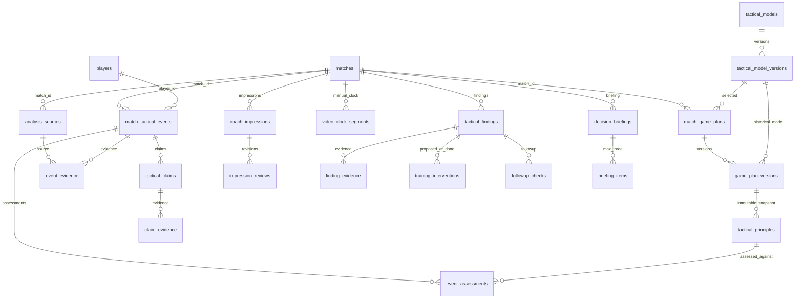

# Modello dati Viceallenatore AI, fase 1

La migrazione `20261120120000_viceallenatore_phase1.sql` aggiunge tabelle a Supabase senza modificare quelle esistenti. `match_id` e `player_id` sono `text` e puntano a `public.matches` e `public.players`. Non esiste un'associazione verificata tra `matches` e `lnd_seasons`: `season_id` nel modello stagionale è opzionale e punta al registro LND solo se lo staff ha verificato il legame. Le squadre avversarie delle partite Analytics sono ancora testo in `matches.partita`; `lnd_teams` appartiene a un flusso distinto e non viene attribuito automaticamente.

## Semantica

- L'evento è un fatto registrato con tempo video in millisecondi. Il cronometro di gara è un dato separato; `clock_mapping_verified=false` non permette conversioni implicite.
- `video_clock_segments` registra tratti continui e verificati manualmente. Un evento può essere marcato sincronizzato soltanto se cade nello stesso filmato e periodo di un tratto verificato, e lo staff conferma esplicitamente il minuto. Tagli e recupero richiedono tratti separati.
- `tactical_claims.claim_type` distingue **osservazione**, **interpretazione**, **ipotesi**. Fonte, evidenza, qualità, osservabilità, confidenza, revisione e validità sono campi distinti. Una deduzione AI non diventa fatto attraverso l'approvazione.
- `event_assessments` distingue conformità al piano e qualità tecnica. Il denominatore di conformità include solo episodi pertinenti, osservabili, giudicati e collegati alla versione approvata. `non_valutabile` è contato fuori denominatore.
- Un finding registra violazioni e opportunità osservate. La conferma richiede un episodio valutato e una clip collegata; la ricorrenza richiede confrontabilità tra partite e nessuna soglia automatica è in fase 1.
- Proposta, approvazione ed esecuzione dell'allenamento sono distinte. Il follow-up non dimostra causalità.
- Versioni approvate e principi associati sono protetti da trigger. Ogni `game_plan_versions.model_version_id` conserva il DNA storico anche quando il modello della partita viene aggiornato. Approvare richiede hash della versione, PDF verificato, principi e DNA approvato. Revisioni di impressioni e audit sono append-only per il client. Gli originali non vengono sovrascritti.
- L'archivio locale SQLite contiene path e cache; il bundle JSON scarta `local_path`. Supabase conserva hash e metadati, mai gli originali o un URL video pubblico inventato.

## Accesso e migrazione

RLS: solo un utente Supabase autenticato con profilo `utenti.attivo=true` e ruolo `STAFF` può leggere/scrivere; `anon` e giocatori non ricevono grant. Il frontend usa la chiave publishable e la sessione utente. Prima del deploy fare backup del DB di sviluppo e applicare la migration lì. La migration non è stata applicata automaticamente dal lavoro locale. Per rollback in sviluppo eliminare le nuove tabelle in ordine inverso solo dopo backup e verifica delle dipendenze; in produzione preferire migration correttiva, non DROP. Il workflow GitHub esistente invia le migration in produzione solo dopo il merge su `main`.

Il contratto canonico è [`event-contract.json`](event-contract.json). Il motore locale lo carica e serializza eventi annidati; la UI ne valida campi e classificazioni prima di adattarli alle tabelle relazionali. Versioni: `event_schema_version`, `analysis_pipeline_version`, versione numerica del Game Plan e del Tactical Model. La UI non interpreta ID non verificati da MHTML come giocatori/partite canonici.
